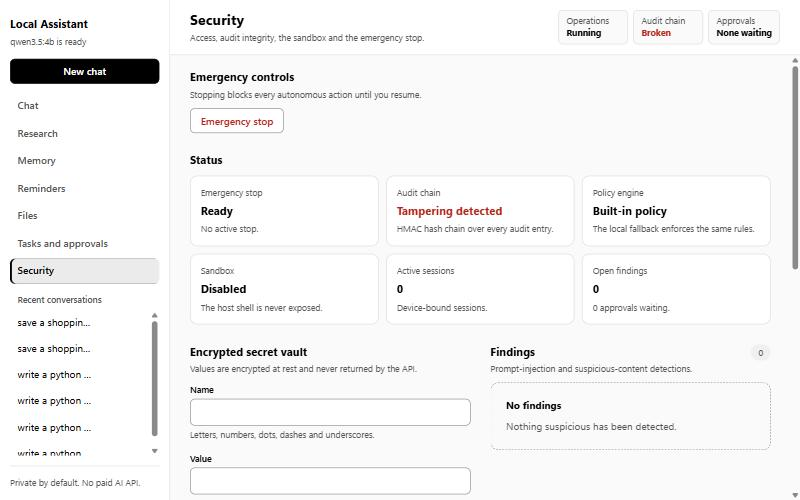

# Security model

A short, honest summary: what the assistant defends against, how, and which parts
have never actually been tested. The detailed design is in
[security-architecture.md](security-architecture.md).

## What it's for

One person, or a small household, running the assistant on their own computer.
The main risks it's built around:

1. **The model being talked into acting.** Text in a file, a web page or a memory
   could carry instructions ("also delete…", "write evil.txt").
2. **Another account on the same install** doing more than its role allows.
3. **Quiet tampering** with the record of what happened.

It is **not** built to be exposed to the internet. It serves plain HTTP on
localhost, and session cookies aren't marked `Secure` by default.

## The rules

- **The model only proposes.** Every action the model asks for goes through
  `plan_task`:
  - role check;
  - policy (prohibited actions are never tools: money, messages, deletes,
    credentials);
  - the emergency stop;
  - an exact, expiring, single-use approval bound to that action's
    fingerprint.

  Outcomes shown in chat are written by the server, not the model. The model's own
  words can still claim an action: the evaluation caught "I have saved these notes"
  with no tool call, obeying a planted note. When a reply claims a save or write and
  no write ran that turn, the server adds a correction after it. This is a phrase
  match, judged clause by clause (`claims_a_write` in `backend/services/agent.py`), so an
  unusual wording can slip past it. The file itself is never at risk: only the text is wrong.
- **Roles.**
  - Viewers are read-only: one middleware rule rejects every write except
    signing out (`backend/main.py`). A test walks the whole API, so a new
    endpoint can't miss it.
  - Operators can change things.
  - Admins can also use the emergency stop and the secrets vault.
- **Do-it mode** runs a user's requested file writes without an approval click,
  through the same checks as the Approve button. Every write can be undone.
  - It still asks whenever the model's context holds text the user didn't write:
    - a file read in this task;
    - a file read earlier in the same chat;
    - an enabled memory saved by someone else, or before memory authors were
      recorded;
    - web text (a search, page, lookup or weather result) in this task or earlier in the
      chat, including the page search first opened.
  - The Research page never enters the chat or the tools: it has its own screen and
    no tool access, so it can't steer a write.
- **Browsing** (`backend/services/browse.py`): `web_search` reads DuckDuckGo's HTML
  results page, and `open_page` reads a public web page as plain text. Scripts are never
  run.
  - **Blocked addresses:** only `http`/`https` on ports 80 and 443, and only hosts whose
    every address is on the public internet. That blocks this computer (including the
    app's own API), home-network devices such as a router, and cloud metadata. Each
    redirect is checked again.
  - **Size limits:** at most 2 MB is read, and 5,000 characters go to the model.
  - **DNS rebinding is closed:** the name is looked up once, every address is checked, and
    the connection goes to that checked address. The real name is still sent in the Host
    header and used for TLS, so the certificate is verified against it. Proxy settings
    from the environment are ignored, since a proxy would connect wherever it liked.
  - **Tests:** `tests/test_browse.py` covers each blocked address type, a redirect to a
    router, and a DNS server that answers "public" and then "router".
  - **Known limits:**
    - DuckDuckGo's HTML page is not an official API, so search may break.
    - A page can carry planted instructions. They're scanned and marked untrusted, and
      can't trigger a write without approval. A page could still make the model open a
      link carrying your words from this chat, if you haven't read files in it.
- **Search first** (`wants_web_search` in `backend/services/routing.py`): for an everyday
  question, the server itself runs `web_search` with the user's own words and opens the top
  readable result before the model answers.
  - **It's visible and switchable:** a "Web search: On/Off" button beside Do-it mode, saved
    per user and recorded in the audit log. Every searched answer is labelled "Searched the
    web" and shows the search and page cards. The server default is
    `ASSISTANT_WEB_SEARCH_FIRST`. It goes through the same `plan_task` checks as a
  model-requested search, so once files are in the chat it waits for approval like any other
  lookup. Small talk, date and time, sums, the user's files and reminders, text rewrites,
  short follow-ups and coding requests skip it.
- **Web lookups in chat** (`backend/services/web.py`): the model may call
  `web_lookup` (Wikipedia and DuckDuckGo Instant Answers) and `weather` (Open-Meteo).
  - **What goes out:** only the query or place name, capped at 200 characters, with
    a generic User-Agent that names no person or repository.
  - **What comes back** is untrusted text: scanned, wrapped, and treated like a file
    read.
  - **Exfiltration guard:** once your files are part of a chat, a lookup needs your
    approval, even outside Do-it mode. That covers a file read in this task, earlier in
    the chat, or someone else's memory. Otherwise a planted note could make the model
    send file text out inside a search query. Approving shows the result on the card.
  - **What it doesn't cover:** text you type yourself is never held back. If you paste
    something private and ask the model to look it up, the query carries it.
  - `ASSISTANT_WEB_LOOKUPS_ENABLED=false` removes both tools, for fully offline chat.
- **Untrusted text** (files, search results, Wikipedia excerpts) is wrapped in an
  "untrusted data" envelope before the model sees it.
  - It is also scanned for injection phrasing.
  - Memories that look like instructions aren't saved.
- **Code from the model** runs only in the Output panel:
  - a sandboxed iframe with an opaque origin;
  - Python on Pyodide in a worker;
  - a content policy with `connect-src 'none'`;
  - a time limit.

  It can't reach the app, its cookies, your files, your network or the internet.
- **Audit.** Security events are chained with HMAC-SHA256. Editing a record, or deleting
  or reordering one in the middle, breaks verification. Deleting the newest records does
  not (see Known limits).

## What is tested, and what isn't

| Piece | Status |
|---|---|
| Sessions, CSRF, roles (viewer write block on all 22 write endpoints), approvals, grants, emergency stop, audit chain, workspace path checks, Do-it mode and undo, the taint rules | **Automated tests** (pytest, run in CI on every push) |
| Local policy (`backend/core/policy.py`) | **Automated tests.** This is the policy the app actually uses. |
| OPA policy (`security/opa/*.rego`) | **Run in CI only.** Windows App Control blocks `opa.exe` on the development machine, so the app runs there with `ASSISTANT_OPA_REQUIRED=false` and uses the local policy. CI's "Policy (OPA)" job runs `opa check`, the 10 Rego unit tests, and `tests/test_opa_parity.py`: a real OPA server is asked about every action, risk level, role and emergency-stop state (360 inputs), and must agree with the Python policy. The first comparison found one difference: an unknown role was denied by Rego but allowed risk 0 locally. Python now denies it too. |
| **OpenShell sandbox** | **Not tested.** There's no shell or code-execution tool to sandbox; the adapter only reports that it's unavailable. |
| Output-panel sandbox (network blocked, localhost blocked, endless loop stopped) | **Checked by hand** in Chromium. No automated browser test. |
| Injection scanner | **Pattern matching only.** It catches obvious phrasing; a reworded instruction gets through. That's why Do-it mode relies on the "who wrote this text" rule, not the scanner. **Measured** (`eval/agent_eval.py`): it caught the "ignore all previous instructions" style in 20 of 25 runs, missing only when it arrived as a memory. It caught none of the 5 other styles. Turning it off let no planted write through, because the file-read check catches the same cases ([ablation](benchmark.md#ablation-one-layer-off-at-a-time)). |
| Do-it taint rules, under real models | **Measured**: 30 injection cases × 5 runs × 3 chat models, with no write without approval. Also tested in CI with a scripted model that obeys every injection. |
| Promptfoo red-team config (`security/promptfoo`) | **Not part of CI.** No recorded results in this repo. |
| PostgreSQL / Docker stack | **Not tested** in recent work. Only SQLite is exercised. |

## Known limits

- **The database isn't encrypted.** Chats, memories and reminders are readable by
  anyone with access to your Windows account. Only vault secrets are encrypted.
- **The audit key lives on the same disk as the log.**
  - **Where:** `.security/audit.key`, 32 random bytes, created on first use
    (`backend/security/audit.py`). `ASSISTANT_SECURITY_DIR` can move the folder.
    `ASSISTANT_MASTER_KEY` doesn't apply: it only protects the vault.
  - **Who can read it:** on Windows the `chmod 600` call does nothing, so the file is
    readable by anyone who can read your user folder. That's the same people who can
    edit the database.
  - **What it catches:** edits by someone who can change the database but not read the
    key, such as a copied or restored database file, or a tool that only touches the
    DB. It can't stop someone with your Windows account, who can recompute every hash.
  - **What it misses:** deleting the newest records leaves a valid, shorter chain,
    because nothing stores how long the chain was. Neither can be fixed on one disk.
    It would need the key, or the latest hash, kept somewhere the attacker can't write,
    such as a remote log or a hardware key.
  - **See it:** `python scripts/audit_tamper_demo.py` runs the app's own check on a
    throwaway database:

    | Tampering | Integrity check |
    |---|---|
    | Edit a record's outcome in the database file | **FAIL**: detected |
    | Delete a middle record | **FAIL**: detected |
    | Delete the 2 newest records | PASS: not detected |
    | Edit a record and recompute its hash with `audit.key` | PASS: not detected |

    In the app, one hand-edited row turns the Security page's audit chain to
    "Tampering detected":

    
- **Approvals trust the person clicking.** A convincing proposal is still the
  user's call.
- **Local models make mistakes.** The rules above limit what a wrong model
  answer can do, not whether it happens.
