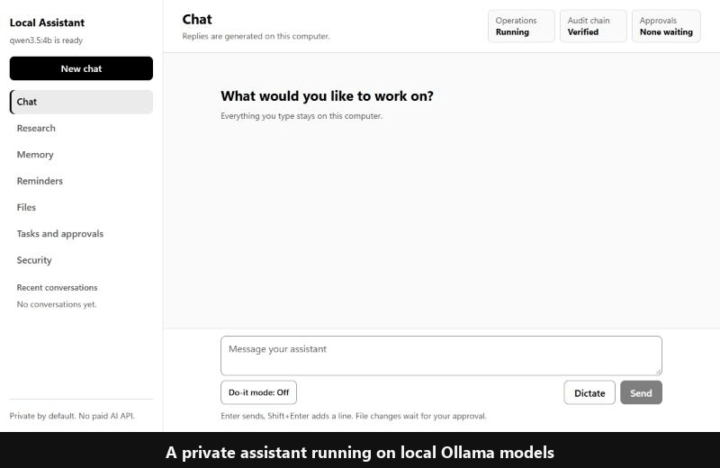
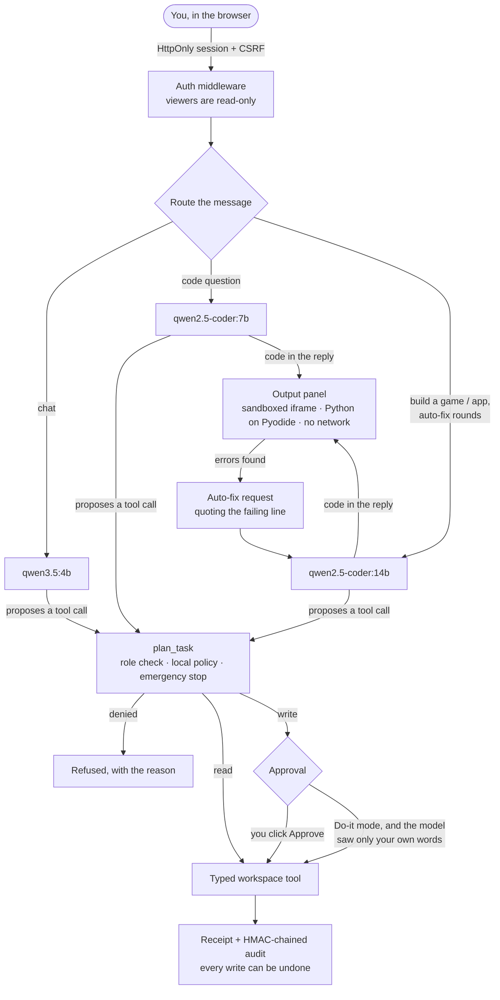

# AI Personal Assistant

[](https://github.com/Hemanth05065/personal-ai/actions/workflows/ci.yml)

A private assistant that runs entirely on your own computer. You chat with local
[Ollama](https://ollama.com) models: they answer questions, work with files in one
workspace folder, set reminders, and write code that runs in a sandboxed panel
beside the chat. Nothing goes to a cloud AI, and nothing costs money.

The model never acts on its own. It can only *propose* an action; the server decides
whether that action is allowed, asks you when it should, runs it, and records it.



## How a request flows



- **Untrusted text is marked as untrusted.** File contents and search results reach the
  model inside an "untrusted data" envelope. Once the model has seen any, Do-it mode
  stops running writes automatically and asks first.
- **Outcomes come from the server.** The chat says "Done" only when the tool's own
  receipt says so; small models otherwise claim actions that never happened.
- **Code is tested before you see it working.** The Output panel runs the code, plays
  games with key presses or feeds Python a sample input, and sends errors back to the
  coder for up to three fixes. It catches crashes, swallowed errors and code that never
  runs, but not every logic bug. See the honest results in
  [CONTINUE_HERE.md](CONTINUE_HERE.md).

Read the [security model](docs/security-model.md) for what is enforced, and which parts
are not tested.

## What it can do

- **Chat** with a local model, with saved conversations you can reopen or delete
- **Coding**: requests are routed to a coding model; HTML, JavaScript and Python run in a
  sandboxed Output panel with a console, Copy, and an Input box for `input()`
- **Workspace files**: list, read, search by meaning (local embeddings) and write files
  in one folder, with approval or Do-it mode, and Undo for every write
- **Reminders** shown in the app and as Windows notifications
- **Memory** you can inspect and delete, used in every chat
- **Research**: cited reports from Wikipedia, summarised locally
- **Safety**: sign-in with device-bound sessions, viewer/operator/admin roles, exact
  single-use approvals, an emergency stop, and a tamper-evident audit log
- **Voice**: browser dictation and read-aloud
- Installable as a PWA; SQLite by default, optional PostgreSQL/Docker stack

Purchases, money transfers, deleting files, changing credentials, physical-security
controls and arbitrary computer control are not tools at all, so the model can't
request them.

## Quick start on Windows

Requirements: Python 3.12+, Node.js 22+, and Ollama. All are free.

```powershell
Set-ExecutionPolicy -Scope Process Bypass
.\scripts\setup.ps1
.\scripts\start.ps1
```

Open <http://localhost:5173>. API documentation is available at
<http://localhost:8000/docs>.

The setup script creates environments, installs dependencies, and downloads
the configured model. The model download is about 3.3 GB and has no usage fee. To skip it:

```powershell
.\scripts\setup.ps1 -SkipModel
```

## Manual setup

```powershell
python -m venv .venv
.\.venv\Scripts\python -m pip install -e ".[dev]"
Copy-Item .env.example .env
npm --prefix apps/web install
ollama pull qwen3.5:4b
```

Run the services in separate terminals:

```powershell
.\.venv\Scripts\python -m uvicorn backend.main:app --reload
npm --prefix apps/web run dev -- --host 127.0.0.1
```

## Configuration

Copy `.env.example` to `.env`.

- `ASSISTANT_DATABASE_URL`: SQLite by default; PostgreSQL is supported.
- `ASSISTANT_OLLAMA_URL`: defaults to `http://127.0.0.1:11434`.
- `ASSISTANT_MODEL`: defaults to `qwen3.5:4b`.
- `ASSISTANT_WORKSPACE_DIR`: the only directory file tools may access.
- `ASSISTANT_MAX_FILE_BYTES`: maximum file read/write size.
- `ASSISTANT_AUTH_REQUIRED`: local user/device authentication (default true).
- `ASSISTANT_API_KEY`: optional administrator service credential.
- `ASSISTANT_OPA_URL` and `ASSISTANT_OPA_REQUIRED`: centralized authorization;
  production containers require it and fail closed when unavailable.
- `ASSISTANT_OPENSHELL_ENABLED`: detects a supported NVIDIA OpenShell install;
  it never enables a host-shell fallback.
- `ASSISTANT_MASTER_KEY`: optional external vault root; otherwise a protected
  local key is created in `.security/`.
- `VITE_API_URL` and `VITE_API_KEY`: matching web-client settings.

Do not put credentials into prompts, memories, task arguments, or audit details.

## Safety and approvals

| Level | Example | Behavior |
|---|---|---|
| 0 | Information | Executes locally |
| 1 | List/read authorized files | Executes in the restricted workspace |
| 2 | Create/edit a file | Waits for explicit approval |
| 3 | Consequential external action | Requires a dedicated integration and approval |
| 4 | Prohibited action | Denied |

Model output and retrieved text are untrusted data. They cannot grant
permissions, change risk levels, or approve actions. Successful tool execution
creates a receipt and audit event.

Approvals display the action, justification, targets, and consequences. Each
grant is bound to the exact serialized action, expires after ten minutes, is
usable once, and is checked again immediately before execution.

## Security pipeline

The backend enforces controls independently of the model:

```text
device session + CSRF/API key -> RBAC -> emergency stop -> OPA/local policy
  -> prompt-injection boundary -> explicit action-bound approval
  -> restricted typed tool (or fail-closed sandbox requirement)
  -> receipt + tamper-evident audit
```

Docker starts official OPA and marks it required. Native development can use
the deterministic local policy while OPA is optional. Arbitrary shell/code
execution is not exposed. A restrictive OpenShell policy is included for
supported environments; on native Windows it remains disabled and unavailable
sandbox execution is denied rather than run on the host.

See [security architecture](docs/security-architecture.md), [security tests](docs/security-testing-report.md),
and the [OpenShell deployment note](security/openshell/README.md).

## Research, voice, and cross-platform use

Research uses Wikipedia's free API and sends retrieved excerpts to the local
Ollama model. Reports include numbered source links.

AI chat remains local. Basic voice dictation and playback use browser/operating
system speech capabilities; offline availability depends on the browser and OS.

The production client is a Progressive Web App. Use the browser's Install or
Add to Home Screen command on Windows, Android, iOS, macOS, or Linux. The
backend must remain reachable from that device.

## Optional Docker stack

```powershell
docker compose up --build
```

This starts PostgreSQL with pgvector, Redis, the API, and the production web UI
at <http://localhost:8080>. Ollama stays on the Windows host for GPU access.
Change the default database password before exposing services to another host.

## Tests and checks

```powershell
.\.venv\Scripts\python -m pytest
.\.venv\Scripts\python -m ruff check --no-cache backend tests
npm --prefix apps/web run build
npm --prefix apps/web audit --audit-level=high
```

Promptfoo red-team configuration is in `security/promptfoo`. Set
`PROMPTFOO_DISABLE_REDTEAM_REMOTE_GENERATION=true` so generation stays on local
Ollama; no paid provider is configured.

## Project layout

```text
apps/web/                   React PWA
backend/api/                HTTP endpoints
backend/core/               configuration and safety policy
backend/models/             database entities and API schemas
backend/services/           Ollama, tools, research, execution, automation
assistant_workspace/        authorized user files (created at runtime)
infrastructure/docker/      container images and nginx configuration
tests/                      API, policy, execution, and security tests
scripts/                    setup and launch scripts
docs/                       architecture and security documentation
```

## External integrations

Email, calendars, cloud storage, smart-home systems, and app-store publishing
are not silently enabled because they require user accounts, credentials, and
provider-specific authorization. Add them only through scoped adapters that
preserve the same approval and audit requirements; never place secrets in model
context.
